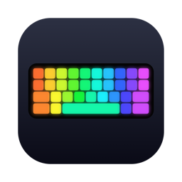

<p align="center"></p>

<h1 align="center">HatorRGB</h1>

<p align="center">
Native macOS menu bar app for the <b>HATOR Gaming Keyboard</b> (USB <code>0416:b23c</code>) —<br>
the vendor only ships Windows software, so this one was built by reverse-engineering the HID protocol.
</p>
<p align="center"></p>
<p align="center"></p>
<p align="center">
</p>

<p align="center"><a href="#українською">🇺🇦 Українською</a></p>

> **Unofficial.** Not affiliated with or endorsed by HATOR.
> Developed and tested on the **HATOR Rockfall EVO TKL Optical** (USB ID `0416:b23c`, Nuvoton NUC121).
> Other keyboards with the same USB ID (Pulsar PCMK TKL, KT108, …) likely work too.

## Features

- **RGB effects**: Static, Breathe, Wave, Neon, Snake, Reactive, Aurora and Ripple. You can set the colour, background, brightness, speed, direction and rainbow mode. Changes apply live.
- **Per-key colours**: an editor window where you paint keys by clicking or dragging. ⌥-click picks up a key's colour. Includes fill-all and presets.
- **Layout calibration**: the app lights each of the 132 LEDs in turn and you press the key that's lit, so the editor matches your exact model.
- **F1–F12 as Mac media keys**: brightness, Mission Control, Spotlight, Launchpad, sleep, music and volume. Every key is configurable. Remapping happens at the HID driver level (`hidutil`) and affects only the HATOR keyboard; no Accessibility permission is needed.
- **Win ↔ Alt toggle**: puts ⌘ next to the space bar. Your other System Settings modifier-key settings are kept.
- **Claude Code alert**: the keyboard softly pulses orange while a Claude Code session waits for your reply or approval. It stops when you answer, or when you come back to Claude or a terminal and touch the keyboard or mouse.
- **App notifications**: when Telegram (or Slack, Mail) gets new unread messages, the keyboard pulses in that app's colour. It reads the Dock badge, so no permissions are needed, and it stops when you open the app. Muted chats don't count. If several alerts are active at once, including Claude, their colours take turns, one per breath.
- **Hotkey overlay**: hold ⌘, ⌥ or ⌃ and the keys that have a shortcut in the frontmost app light up, coloured by menu (File, Edit, View…). An on-screen legend shows what each key does. Shortcuts are read from the app's menu bar, so this needs the Accessibility permission. It's off by default.
- **Snake on the keyboard**: every lit key is a pixel and the arrow keys steer.
- Settings persist and lighting is restored after you reconnect the keyboard. Optional launch at login.

## Install

1. Download `HatorRGB-x.y.z.zip` from [Releases](https://github.com/whatislove23/HatorRGB/releases), unzip it and move `HatorRGB.app` to Applications. The app is universal (Apple Silicon + Intel) and needs macOS 13+.
2. The app is not notarized, so the first time **right-click → Open → Open**. If macOS still refuses, run:
   ```bash
   xattr -dr com.apple.quarantine /Applications/HatorRGB.app
   ```
3. A keyboard icon appears in the menu bar.

### Build from source

```bash
git clone https://github.com/whatislove23/HatorRGB.git
cd HatorRGB
./build-app.sh --install     # builds HatorRGB.app, copies it to ~/Applications and launches it
```

This requires Xcode or the Command Line Tools (Swift 5.9+).

## Claude Code alert setup

Add these hooks to `~/.claude/settings.json`. Adjust the path if the app is in `/Applications`.

```json
"hooks": {
  "Notification": [{ "matcher": "permission_prompt|idle_prompt|elicitation_dialog|agent_needs_input",
                     "hooks": [{ "type": "command", "command": "\"$HOME/Applications/HatorRGB.app/Contents/Resources/hator\" claude wait 2>/dev/null || true" }] }],
  "Stop":             [{ "hooks": [{ "type": "command", "command": "\"$HOME/Applications/HatorRGB.app/Contents/Resources/hator\" claude wait 2>/dev/null || true" }] }],
  "UserPromptSubmit": [{ "hooks": [{ "type": "command", "command": "\"$HOME/Applications/HatorRGB.app/Contents/Resources/hator\" claude clear 2>/dev/null || true" }] }],
  "PostToolUse":      [{ "hooks": [{ "type": "command", "command": "\"$HOME/Applications/HatorRGB.app/Contents/Resources/hator\" claude clear 2>/dev/null || true" }] }],
  "SessionEnd":       [{ "hooks": [{ "type": "command", "command": "\"$HOME/Applications/HatorRGB.app/Contents/Resources/hator\" claude clear 2>/dev/null || true" }] }]
}
```

Sessions are tracked by `session_id`, so several Claude sessions at once work fine.

## CLI

The app bundle includes a `hator` command-line tool:

```bash
H=~/Applications/HatorRGB.app/Contents/Resources/hator
$H effect wave --rainbow --speed 3
$H effect static --color 00ffaa --brightness 2
$H fill ff0000
$H slot 17            # light a single LED slot (for mapping)
```

## Notes

- If you use **Karabiner-Elements**, turn off "Modify events" for the HATOR keyboard in Karabiner → Devices. Otherwise Karabiner bypasses the remapping.
- Changes made with the keyboard's own Fn shortcuts happen inside the firmware and are invisible to the Mac, so after an alert the app restores the lighting set in its menu.
- The release build is ad-hoc signed, so after updating the app macOS may keep a stale Accessibility entry. If the hotkey overlay stops working, remove HatorRGB in System Settings → Privacy & Security → Accessibility and turn the feature on again. When building from source, `SIGN_ID="Apple Development: …" ./build-app.sh` keeps the permission across rebuilds.
- Key remapping only lasts while the app is running. On quit, your System Settings modifier configuration is restored.

## Protocol

Vendor HID interface: usage page `0xFF1B`, usage `0x91`, report ID 1, 63-byte output reports.

| Payload | Meaning |
|---|---|
| `07 00 00 00 0E EF BR SP  R G B  R G B  DR FC` | Key effect: effect, brightness 0–4, speed 0–4, foreground, background, direction, full-colour. `08 … 0D …` sets the logo instead. |
| `09 00 00 NN LL  RGB…` | Per-key colours, message `NN` 0–7. Covers 132 slots on a 6 × 22 matrix; channels max out at `0xC1`. Follow with effect `0x0A` (custom). |

Effects: 0 static, 1 breathe, 2 wave, 3 neon, 5 snake, 6 reactive, 7 aurora, 8 ripple, 10 per-key.
Directions: 0 right, 1 left, 2 up, 3 down, 4 out, 5 in, 6 cw, 7 ccw.

Based on [Daniel Gibson's notes on the Pulsar PCMK TKL](https://gist.github.com/DanielGibson/cd92c5faa6b2e0426351dc44193c6182), which uses the same controller, and verified on HATOR.

## License

[MIT](LICENSE)

---

## Українською

Нативний застосунок для macOS у рядку меню, що керує клавіатурою **HATOR Gaming Keyboard** (USB `0416:b23c`). Офіційний софт є лише для Windows, тому протокол довелося розібрати самому.

> **Неофіційний проєкт**, не пов'язаний з HATOR. Розроблено й перевірено на **HATOR Rockfall EVO TKL Optical** (USB ID `0416:b23c`).

**Можливості:**
- **RGB-ефекти** з кольором, фоном, яскравістю, швидкістю та напрямком.
- **Поклавішний редактор кольорів** із пресетами та калібруванням розкладки.
- **F1–F12 як медіаклавіші Mac**: яскравість, Spotlight, сон, музика, гучність. Працює лише для HATOR, дозволи не потрібні.
- **Перемикач Win ↔ Alt**: ⌘ біля пробілу, як на Mac.
- **Сигнал від Claude Code**: клавіатура плавно блимає помаранчевим, коли Claude чекає на твою відповідь або апрув. Налаштування хуків описано вище.
- **Сповіщення з програм**: нові повідомлення в Telegram (або Slack, Пошті) підсвічують клаву кольором програми. Сигнал зникає, щойно відкриваєш програму. Якщо сигналів кілька, кольори чергуються.
- **Підсвітка гарячих клавіш**: затисни ⌘, ⌥ або ⌃, і світяться клавіші зі скороченнями поточної програми, кольором відповідного меню. На екрані з'являється підказка, що робить кожна клавіша. Потрібен дозвіл «Доступність».
- **Змійка просто на підсвітці клавіатури**, керування стрілками.

**Встановлення:** завантаж zip із [Releases](https://github.com/whatislove23/HatorRGB/releases) і перенеси `HatorRGB.app` у «Програми». Застосунок не нотаризований, тому першого разу відкривай через **правий клік → Відкрити**. Якщо macOS однаково блокує, виконай команду `xattr -dr com.apple.quarantine /Applications/HatorRGB.app`.

**Збірка з коду:** `./build-app.sh --install`.
